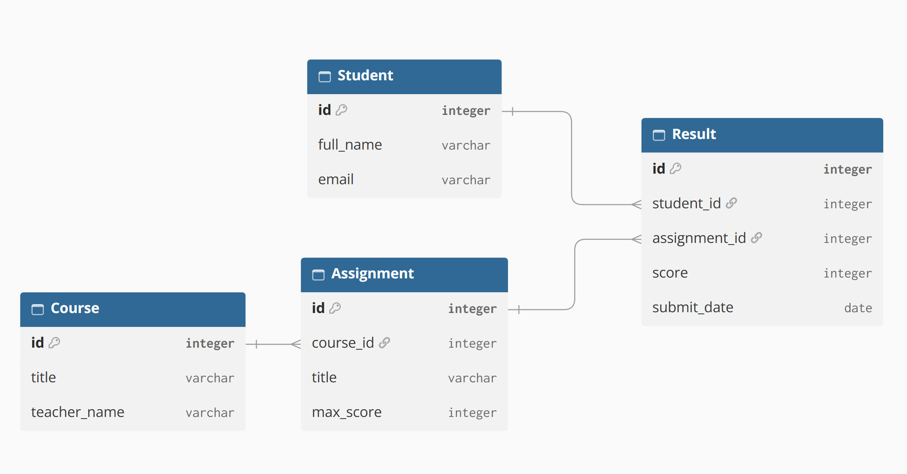

# Анализ и моделирование данных предметной области

## 1. Описание предметной области

**Предметная область:** Образовательная платформа (онлайн-обучение).

Образовательная платформа предназначена для предоставления учебных материалов, проведения занятий и контроля знаний в дистанционном формате.

**Основные процессы:**
- регистрация студентов на платформе;
- ведение учебных курсов (создание и редактирование);
- публикация учебных материалов;
- запись студентов на курсы;
- выдача заданий преподавателями;
- выполнение заданий студентами;
- хранение результатов обучения (оценок).

**Пользователи системы:**
- студенты (обучающиеся);
- преподаватели (инструкторы);
- администраторы платформы.

**Основные задачи информационной системы:**
- хранение информации о пользователях (студентах и преподавателях);
- ведение каталога курсов;
- учет записей студентов на курсы;
- хранение учебных заданий;
- учет сданных студентами работ и выставленных за них оценок.

## 2. Объекты данных

В предметной области выделены следующие основные объекты данных.

### Студент
Пользователь платформы, который проходит обучение на курсах.

Необходимо хранить:
- идентификатор студента;
- ФИО;
- адрес электронной почты;
- дату регистрации.

### Преподаватель
Пользователь платформы, который создает курсы и проверяет задания.

Необходимо хранить:
- идентификатор преподавателя;
- ФИО;
- адрес электронной почты;
- специализацию.

### Курс
Учебный курс, содержащий материалы и задания.

Необходимо хранить:
- идентификатор курса;
- идентификатор преподавателя (автора);
- название;
- описание;
- статус (опубликован/черновик).

### Запись на курс (Enrollment)
Факт зачисления студента на конкретный курс.

Необходимо хранить:
- идентификатор записи;
- идентификатор студента;
- идентификатор курса;
- дату записи;
- текущий статус обучения (в процессе, завершен).

### Задание
Учебная задача, которую студент должен выполнить в рамках курса.

Необходимо хранить:
- идентификатор задания;
- идентификатор курса;
- название;
- описание;
- максимальный балл.

### Результат (Сдача задания)
Информация о выполненном задании студентом и полученной оценке.

Необходимо хранить:
- идентификатор результата;
- идентификатор задания;
- идентификатор студента;
- дату сдачи;
- полученный балл;
- комментарий преподавателя.

## 3. Атрибуты объектов

Для каждого объекта были определены основные атрибуты и предполагаемые типы данных.

### Студент

| Атрибут | Тип данных | Описание |
|---|---|---|
| id | Число | Уникальный идентификатор студента |
| full_name | Строка | ФИО студента |
| email | Строка | Электронная почта |
| reg_date | Дата | Дата регистрации на платформе |

### Преподаватель

| Атрибут | Тип данных | Описание |
|---|---|---|
| id | Число | Уникальный идентификатор преподавателя |
| full_name | Строка | ФИО преподавателя |
| email | Строка | Электронная почта |
| specialization | Строка | Специализация (например, "Программирование") |

### Курс

| Атрибут | Тип данных | Описание |
|---|---|---|
| id | Число | Уникальный идентификатор курса |
| teacher_id | Число | Идентификатор преподавателя |
| title | Строка | Название курса |
| description | Строка | Описание курса |
| is_published | Логическое значение | Флаг (Опубликован: да/нет) |

### Запись на курс

| Атрибут | Тип данных | Описание |
|---|---|---|
| id | Число | Уникальный идентификатор записи |
| student_id | Число | Идентификатор студента |
| course_id | Число | Идентификатор курса |
| enroll_date | Дата | Дата записи на курс |
| status | Справочные данные | Статус (в процессе, завершен, отменен) |

### Задание

| Атрибут | Тип данных | Описание |
|---|---|---|
| id | Число | Уникальный идентификатор задания |
| course_id | Число | Идентификатор курса |
| title | Строка | Название задания |
| description | Строка | Текст задания |
| max_score | Число | Максимально возможный балл |

### Результат

| Атрибут | Тип данных | Описание |
|---|---|---|
| id | Число | Уникальный идентификатор результата |
| assignment_id | Число | Идентификатор задания |
| student_id | Число | Идентификатор студента |
| submit_date | Дата | Дата сдачи задания |
| score | Число | Полученный балл |
| feedback | Строка | Комментарий преподавателя |

## 4. Классификация данных

Выделенные данные можно классифицировать по их назначению и типу.

| Категория данных | Примеры атрибутов | Назначение |
|---|---|---|
| Текстовые | full_name, email, title, description, feedback | Хранение текстовой информации |
| Числовые | id, max_score, score | Хранение числовых значений (идентификаторы, баллы) |
| Даты и время | reg_date, enroll_date, submit_date | Хранение информации о времени событий |
| Логические | is_published | Флаг состояния (да/нет) |
| Справочные | status (в записи на курс) | Выбор из строго заданного списка значений |
| Вычисляемые | Итоговый балл за курс | Рассчитывается как сумма/среднее баллов за все задания |

## 5. Связи между объектами

Между объектами предметной области были определены следующие связи.

### Преподаватель - Курс
**Тип связи:** один ко многим (1:N).
Один преподаватель может вести несколько курсов. Каждый курс создается одним преподавателем.

### Студент - Курс
**Тип связи:** многие ко многим (M:N).
Один студент может записаться на несколько курсов. На один курс могут быть записаны многие студенты.
*Реализуется через промежуточную сущность «Запись на курс».*

### Курс - Задание
**Тип связи:** один ко многим (1:N).
Один курс содержит множество заданий. Каждое задание относится только к одному курсу.

### Студент - Задание
**Тип связи:** многие ко многим (M:N).
Один студент может сдать много заданий. Одно задание могут сдать многие студенты.
*Реализуется через промежуточную сущность «Результат» (Сдача задания).*

## 6. Концептуальная модель данных

На схеме отражены следующие связи:
- Преподаватель 1:N Курс;
- Студент M:N Курс (через Запись на курс);
- Курс 1:N Задание;
- Студент M:N Задание (через Результат).

## 7. Оценка качества исходных данных

**1. Достаточно ли объектов выделено?**
Да. Выделенные объекты полностью покрывают процессы регистрации, ведения курсов, выдачи заданий и хранения результатов.

**2. Отсутствуют ли важные сущности?**
Для базовой модели платформы сущностей достаточно. В будущем можно добавить сущности «Учебный материал» (видео/текст) и «Платеж» (если курсы платные), а также «Категория курса».

**3. Все ли необходимые атрибуты определены?**
Определены ключевые атрибуты для идентификации объектов и хранения основной информации. При детальной проработке можно добавить атрибуты для хранения ссылок на файлы или время просмотра лекций.

**4. Имеются ли дублирующиеся данные?**
Нет. Модель нормализована: данные о студентах и преподавателях хранятся в соответствующих таблицах, а связь между ними и курсами реализована через внешние ключи (id).

**5. Достаточно ли информации для дальнейшего проектирования?**
Да. Выделенные объекты, их атрибуты и связи (с типами 1:N и M:N) готовы к преобразованию в физическую схему базы данных (SQL).

**Вывод:**
В ходе лабораторной работы была проанализирована предметная область образовательной платформы. Выделены 6 основных сущностей, описаны их атрибуты и типы данных. Определены связи (1:N и M:N) и построена концептуальная модель. Модель является полной и логичной для реализации базового функционала системы онлайн-обучения.
