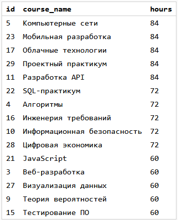
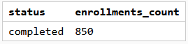
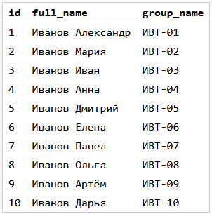
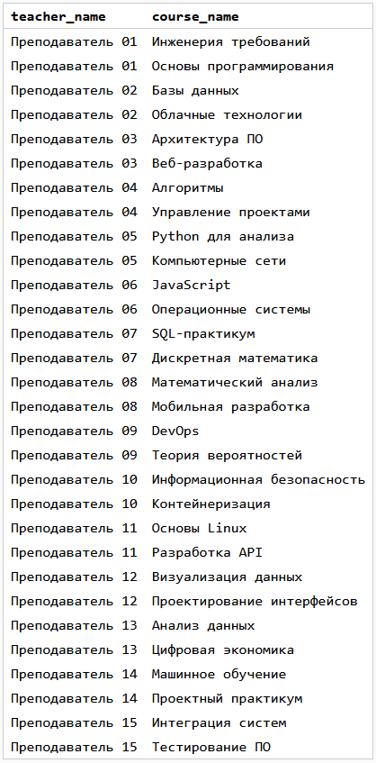
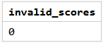
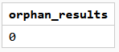
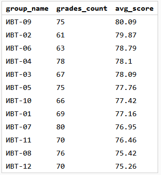
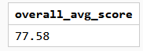

# Анализ учебного набора данных с помощью SQL

**Вариант:** 2 

## 1. Описание набора данных

В базе данных 6 таблиц, описывающих образовательный процесс. Основные из них:

| Таблица | Назначение | Основные поля | Записей |
|---|---|---|---:|
| `students` | Студенты | `id`, `full_name`, `group_id`, `admission_year` | 240 |
| `courses` | Курсы | `id`, `course_name`, `hours`, `teacher_id` | 30 |
| `results` | Итоговые оценки | `id`, `enrollment_id`, `score`, `completed_at` | 850 |
| `groups` | Учебные группы | `id`, `group_name`, `study_year` | 12 |
| `teachers` | Преподаватели | `id`, `full_name`, `department` | 15 |
| `enrollments` | Записи на курсы | `id`, `student_id`, `course_id`, `enrolled_at`, `status` | 1000 |

**Связи между таблицами:**
*   `students.group_id` → `groups.id` (каждый студент в группе)
*   `courses.teacher_id` → `teachers.id` (курс ведет преподаватель)
*   `enrollments.student_id` → `students.id` и `enrollments.course_id` → `courses.id` (связь многие-ко-многим через таблицу записей)
*   `results.enrollment_id` → `enrollments.id` (оценка привязана к конкретной записи на курс)

## 2. Аналитические вопросы

1. *(Вариант 2)* Какие учебные группы показывают лучшие средние результаты обучения? Сравните группы с учётом числа оценок. (`groups`, `students`, `enrollments`, `results`)
2. Сколько студентов в каждой группе? (`groups`, `students`)
3. Какие преподаватели ведут больше всего курсов? (`teachers`, `courses`)
4. Каково распределение записей на курсы по статусам? (`enrollments`)
5. Какой средний балл у каждого курса? (`courses`, `enrollments`, `results`)
6. Есть ли студенты, которые ни разу не записались на курсы? (`students`, `enrollments`)
7. Как соотносятся длительность курса и средний балл по нему? (`courses`, `results`)

## 3. Фильтрация и сортировка

**Аналитический вопрос:** Вывести курсы длительностью не менее 60 часов, отсортировав по убыванию продолжительности и названию.

**SQL-запрос:**

```sql
SELECT id, course_name, hours 
FROM courses 
WHERE hours >= 60 
ORDER BY hours DESC, course_name ASC;
```

**Результат запроса:**


**Пояснение:** Оператор `WHERE` отфильтровал курсы короче 60 часов. `ORDER BY` отсортировал оставшиеся записи сначала по убыванию количества часов, а затем по алфавиту.

## 4. Агрегирование и группировка

**Аналитический вопрос:** Вывести статусы записей на курсы, оставив только те, где записей больше 100.

**SQL-запрос:**

```sql
SELECT status, COUNT(*) AS enrollments_count 
FROM enrollments 
GROUP BY status 
HAVING COUNT(*) > 100;
```

**Результат запроса:**


**Пояснение:** `GROUP BY` сгруппировал данные по статусу. **Разница между WHERE и HAVING:** `WHERE` фильтрует строки до группировки, а `HAVING` фильтрует уже сгруппированные данные (результаты агрегатных функций). Здесь `HAVING` оставил только статус `completed` (850 записей).

## 5. Анализ связанных таблиц

**Аналитический вопрос:** Вывести студентов с их группами, а также всех преподавателей (включая тех, у кого нет курсов).

**SQL-запрос:**

```sql
-- 1. Студенты и группы (INNER JOIN)
SELECT s.id, s.full_name, g.group_name 
FROM students AS s 
INNER JOIN groups AS g ON g.id = s.group_id 
ORDER BY s.id LIMIT 10;

-- 2. Все преподаватели и их курсы (LEFT JOIN)
SELECT t.id, t.full_name AS teacher_name, c.course_name 
FROM teachers AS t 
LEFT JOIN courses AS c ON c.teacher_id = t.id 
ORDER BY t.id;
```

**Результат запроса:**



**Пояснение:** `INNER JOIN` возвращает только совпадающие строки из обеих таблиц. `LEFT JOIN` (во 2-м запросе) сохраняет всех преподавателей из левой таблицы, даже если у них нет курсов (в нашем случае у всех 15 преподавателей есть курсы, поэтому вывелось 30 строк).

## 6. Проверка корректности

**Что проверялось:** Наличие невалидных оценок (вне диапазона 0-100) и "осиротевших" результатов (ссылающихся на несуществующие записи).

**Способ проверки:**

```sql
-- 1. Невалидные оценки
SELECT COUNT(*) AS invalid_scores 
FROM results 
WHERE score < 0 OR score > 100 OR score IS NULL;

-- 2. Осиротевшие результаты
SELECT COUNT(*) AS orphan_results 
FROM results AS r 
LEFT JOIN enrollments AS e ON r.enrollment_id = e.id 
WHERE e.id IS NULL;
```

**Результат проверки:**



| Проверка | Ожидаемое значение | Полученное значение | Итог |
| :--- | :--- | :--- | :--- |
| Невалидные оценки | 0 | 0 | ✅ |
| Осиротевшие результаты | 0 | 0 | ✅ |

## 7. Аналитические выводы

**Основной вопрос варианта:** Какие учебные группы показывают лучшие средние результаты обучения? Сравните группы с учётом числа оценок.

**SQL-запрос:**

```sql
SELECT 
    g.group_name, 
    COUNT(r.score) AS grades_count, 
    ROUND(AVG(r.score), 2) AS avg_score
FROM groups AS g
INNER JOIN students AS s ON g.id = s.group_id
INNER JOIN enrollments AS e ON s.id = e.student_id
INNER JOIN results AS r ON e.id = r.enrollment_id
WHERE r.score IS NOT NULL
GROUP BY g.id, g.group_name
ORDER BY avg_score DESC;
```

**Результат запроса:**



**Ответ по данным:**
Лучший средний результат показывает группа **ИВТ-09** со средним баллом **80.09** (учтено 75 оценок). Наихудший результат — у группы **ИВТ-12** со средним баллом **75.26** (учтено 70 оценок). Общий средний балл по всей базе составляет **77.58**.

**Вывод 1:** Разница между лучшей и худшей группой составляет 4.83 балла (80.09 против 75.26), что является заметным отклонением. Группа ИВТ-09 демонстрирует стабильно высокий результат, превышающий средний по базе на 2.51 балла.
**Вывод 2:** Количество оценок в группах варьируется от 61 до 80. Выборка является достаточно равномерной, поэтому высокие позиции ИВТ-09 не являются следствием малого количества оценок или случайности.
**Вывод 3:** В то время как ИВТ-09 и ИВТ-02 (79.87) находятся выше среднего уровня (77.58), группы ИВТ-08 (75.42) и ИВТ-12 (75.26) значительно отстают, что может требовать дополнительного внимания преподавателей.

**Ограничения анализа:** Анализ учитывает только завершенные записи с выставленными оценками (`score IS NOT NULL`). Студенты, которые отчислились или еще проходят обучение (статусы active/cancelled), не учитываются. Кроме того, разные курсы могут иметь разную сложность и строгость оценивания, что не отражено в данном запросе и может влиять на средний балл группы.
